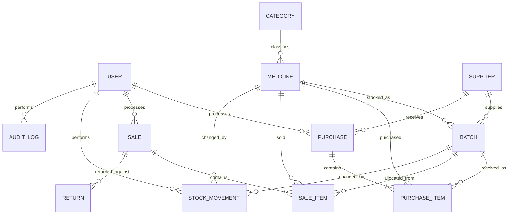

# PharmaCare

PharmaCare is a MERN pharmacy management system for authenticated pharmacy
operations: catalog management, supplier purchasing, batch-based inventory,
FEFO sales, returns, audit history, and operational reports. The React
workspace is role-aware; authorization and business rules are enforced by the
Express API, not by client navigation.

## Features

- Customer registration, JWT login, logout/session revocation, profile, and
  admin-managed roles and account activation.
- Medicine and category CRUD, medicine search/filter/sort/pagination, supplier
  CRUD, activation, filtering, and purchase history.
- Transactional purchases that receive distinct batches, calculate totals on
  the server, and record stock movements and audit events.
- FEFO inventory allocation; expired, empty, and inactive-medicine batches are
  not eligible for sale.
- Transactional sales, server-calculated batch prices/tax/discount, printable
  invoices, and idempotent submissions.
- Returns tied to original sale items; returned stock remains pending
  inspection and is not automatically made sellable.
- Reasoned stock adjustments, append-only stock movement and audit history.
- Aggregated dashboard and sales, stock, expiry, supplier, movement, and audit
  reports.
- Responsive React interface with role-aware navigation, Recharts analytics,
  form validation, loading/error/empty states, and API-backed operations.
- Customer catalog responses expose the FEFO-available unit price without
  exposing reorder levels or batch cost data.
- OpenAPI documentation and Swagger UI at `/api/docs`.

## Technology

| Area | Technologies |
| --- | --- |
| Frontend | React, Vite, Tailwind CSS, Axios, React Router, Recharts, Lucide |
| Backend | Node.js, Express, Mongoose, MongoDB |
| Identity and security | JWT, bcryptjs, Zod validation, Helmet, CORS, express-rate-limit |
| Tests | Node.js test runner, Jest, Supertest |

## Architecture

```text
React pages and feature API clients
             │ Axios / Bearer JWT
             ▼
Express routes → authentication → role/permission checks → Zod validation
             │
             ▼
Controllers → domain services → Mongoose models → MongoDB
                         │
                         └─ Transactions for purchase, sale, return,
                            adjustment, movement, and audit writes
```

Services own business logic; controllers adapt HTTP requests/responses; route
middleware authenticates, authorizes, and validates. Stock is not stored on a
Medicine document. Available stock is derived from individual batches, and
transactional conditional updates prevent overselling.

The client uses a small Axios client and feature API modules under
`client/src/features`. `AuthProvider` holds the signed-in user and token-backed
session. The application layout filters navigation by role for usability;
every protected operation is still authorized by the backend.

## Project structure

```text
client/
  src/
    components/       Protected route
    features/         Auth, catalog, and operations API modules
    lib/              Axios client and API error formatting
    pages/            Login, registration, dashboard, catalog, POS, reports
    App.jsx           Routes, auth provider, role-aware application shell
server/
  src/
    auth/             Role names and permissions
    config/           Environment, database, OpenAPI definition
    controllers/      HTTP request/response handlers
    middleware/       JWT, authorization, rate limiting, validation, errors
    models/           Mongoose documents and indexes
    routes/           REST API route definitions
    services/         Authentication, catalog, stock, and reporting logic
    validators/       Zod input schemas
  test/               Node tests and Jest/Supertest integration tests
docs/
  TECHNICAL-REPORT.md
```

## Data model and relationships



`Purchase` and `Sale` embed historical line-item snapshots (names, batch
numbers, quantities, and prices) while retaining references to their supplier,
medicine, and batch documents. A `Return` references the original sale and
captures its processed items and inspection status. `StockMovement` and
`AuditLog` are append-only histories.

## Prerequisites

- Node.js 20.19+ or 22.12+ (a currently supported Node.js release is
  recommended)
- npm
- MongoDB; purchase, sale, return, and adjustment workflows require a replica
  set or `mongos` to support transactions

## Local installation

```sh
cp server/.env.example server/.env
# Edit server/.env and set a unique JWT_SECRET (at least 32 characters).
npm install --prefix server
npm install --prefix client
```

Start MongoDB, then run in separate terminals:

```sh
npm run dev --prefix server
npm run dev --prefix client
```

The API defaults to `http://localhost:5001`; Vite prints its client address.
API readiness is available at `/api/health`. Interactive API documentation is
at `/api/docs`, with the JSON OpenAPI definition at `/api/docs.json`.

## Environment variables

`server/.env.example` lists the backend settings:

| Variable | Purpose | Default |
| --- | --- | --- |
| `NODE_ENV` | Runtime environment | `development` |
| `PORT` | API listening port | `5001` |
| `MONGODB_URI` | MongoDB connection string | Local `pharmacare` database |
| `CLIENT_ORIGIN` | Allowed browser origin for CORS | `http://localhost:5173` |
| `JWT_SECRET` | Signing secret; use a random private value, minimum 32 chars | Must be set |
| `JWT_ACCESS_TOKEN_TTL` | JWT lifetime (`15m` default) | `15m` |
| `SALES_TAX_RATE` | Tax fraction from `0` to `1` | `0` |
| `MAX_SALE_DISCOUNT_PERCENT` | Maximum discount percentage | `20` |
| `PHARMACY_NAME` | Printed invoice heading | `PharmaCare Pharmacy` |

The frontend accepts `VITE_API_URL` to override its API base URL and
`VITE_CURRENCY` to set the display currency (ISO 4217; defaults to `USD`).
`client/.env.example` documents these values. Never put server secrets in
`VITE_*` variables. Environment files are ignored by Git; only `.env.example`
files are intended to be tracked.

## Database seed

With the backend environment configured and MongoDB running:

```sh
npm run seed --prefix server
```

The seed inserts missing development catalog/sample records; it does not
overwrite existing values. It does **not** create a demo admin password.
Public registration always creates a customer account. Create the first staff
administrator only through a trusted, private bootstrap procedure and set a
new password; do not use a committed password or public registration to grant
staff roles.

## API and permissions

All protected routes require `Authorization: Bearer <access-token>`. The
supported roles are `admin`, `pharmacist`, `cashier`, and `customer`. Customers
are limited to catalog reads and cannot call purchasing, batch inventory,
adjustment, internal reporting, or user-management endpoints. Server-side
middleware enforces access independent of the UI.

The OpenAPI reference at `/api/docs` is the authoritative route overview.
Business write requests are validated on the server. Purchase/sale/return/
adjustment data and stock totals are never trusted from frontend calculations.

## Tests and verification

```sh
npm test --prefix server
npm run test:coverage --prefix server
npm run lint --prefix client
npm run build --prefix client
```

The backend suite includes Node unit/service/API tests plus Jest/Supertest
HTTP integration tests. MongoDB transaction behavior should additionally be
verified against a replica-set test database; mocked service tests do not
replace a production-like integration environment.

## Demo credentials

No fixed demo username/password is provided or committed. A customer can
register from the client. Staff credentials must be provisioned securely by
the system owner; do not publish development passwords in this repository.

## Known limitations and submission checklist

- Sales currently represent the cashier/processor and do not associate a
  customer account with an invoice. Consequently, customer-specific purchase
  history and personal invoice browsing are not available yet.
- The customer catalog price is the selling price of the earliest eligible
  batch; a multi-batch sale may contain different historical batch prices.
- No real payment gateway is integrated; payment methods are simulated.
- Returned inventory remains quarantined as pending inspection; a dedicated
  inspection/release workflow is not part of this implementation.
- Production deployment, production secrets, backups, monitoring, and an
  operational staff-admin bootstrap must be configured by the deployer.
- Review current test and dependency-audit output for the target deployment
  environment before publishing; do not claim a deployment URL or demo
  credentials that have not been provisioned.
- Confirm `.env` files and local build artifacts are untracked, configure a
  replica-set MongoDB URI, and provision staff access securely before a live
  demonstration.

## AI attribution

GitHub Copilot was used as an AI-assisted development tool. The project
maintainer is responsible for reviewing, testing, and maintaining the resulting
code and documentation.
