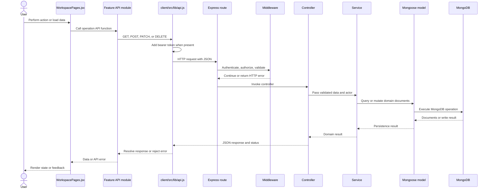
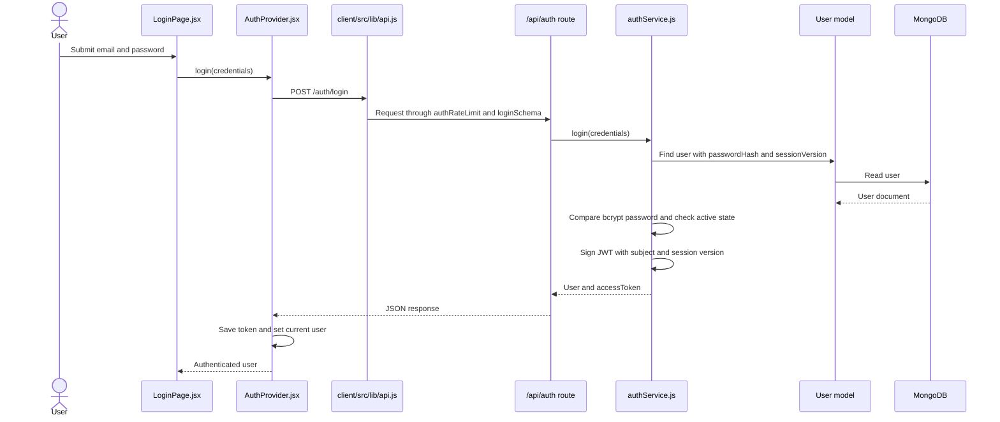
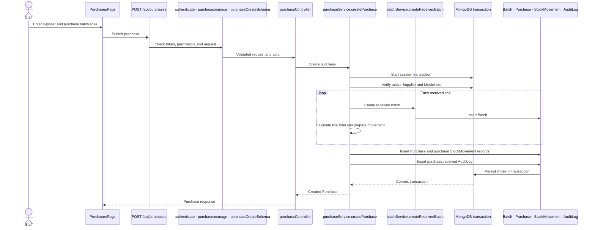
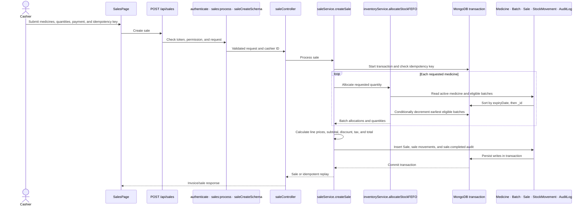
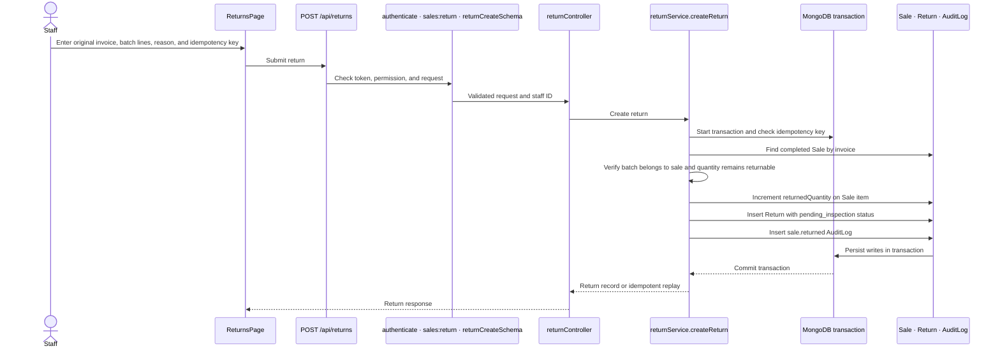

# PharmaCare Architecture

This document describes the architecture implemented in the repository. It
names the current client modules, API route groups, middleware, services, and
Mongoose models; it does not describe planned or hypothetical components.

## 1. Architecture Overview

PharmaCare is a browser-based React application backed by an Express API and
MongoDB. The client sends JSON requests through Axios. Express routes apply
authentication, authorization, and Zod validation before controllers call
domain services. Services perform business rules and use Mongoose models to
read or write MongoDB documents.

```mermaid
flowchart LR
    Browser["Browser"]
    React["React client<br/>App.jsx · WorkspacePages.jsx"]
    Axios["Axios API client<br/>client/src/lib/api.js"]
    Express["Express app<br/>server/src/app.js"]
    Middleware["Auth · permission · Zod validation"]
    Controllers["Controllers"]
    Services["Domain services"]
    Models["Mongoose models"]
    Mongo[("MongoDB")]

    Browser --> React
    React --> Axios
    Axios -->|HTTP JSON + bearer token| Express
    Express --> Middleware
    Middleware --> Controllers
    Controllers --> Services
    Services --> Models
    Models --> Mongo
    Mongo --> Models
    Models --> Services
    Services --> Controllers
    Controllers -->|JSON response| Axios
    Axios --> React
```

The backend is organized around route/controller/service/model boundaries.
Write workflows that affect multiple records use MongoDB sessions and
transactions. Inventory quantity is stored on `Batch`, while
`StockMovement` and `AuditLog` preserve histories for applicable operations.

## 2. Architectural Pattern

The application uses a client/server architecture with a layered backend:

1. **Presentation layer:** React routes, pages, and shared UI state.
2. **API transport layer:** Axios on the client and Express routers on the
   server.
3. **Request boundary:** authentication, permission middleware, and
   `validateRequest` Zod schemas.
4. **HTTP adapter layer:** controllers translate validated request data into
   service calls and responses.
5. **Business/domain layer:** service modules implement catalog, purchase,
   inventory, sale, return, authentication, and reporting rules.
6. **Persistence layer:** Mongoose models and MongoDB.

The code does not use a separate message broker or microservice boundary.
Controllers call services in-process, and services access MongoDB through
Mongoose.

## 3. Frontend Architecture

`client/src/main.jsx` mounts the React application. `client/src/App.jsx`
configures `BrowserRouter`, `AuthProvider`, the `ProtectedRoute` wrapper, and
the role-aware workspace routes.

- **Authentication state:** `client/src/features/auth/AuthProvider.jsx`
  manages the user and access token lifecycle. It exposes login, registration,
  logout, and current-user state through `useAuth`.
- **API transport:** `client/src/lib/api.js` creates the Axios instance using
  `VITE_API_URL` (defaulting to `http://localhost:5001/api`) and adds the
  stored bearer token to requests.
- **Feature API modules:** `client/src/features/auth/api.js`,
  `client/src/features/catalog/api.js`, and
  `client/src/features/operations/api.js` group related endpoint calls.
- **Pages:** `client/src/pages/WorkspacePages.jsx` implements workspace
  screens, including dashboard, medicine catalog, categories, suppliers,
  purchases, inventory, sales, returns, movements, reports, and user
  management. The sales chart is loaded from `SalesTrendChart.jsx`.
- **Navigation:** `App.jsx` defines page routes and navigation links per
  role. The `ProtectedRoute` component requires an authenticated user.

The route/page checks improve navigation and user experience; they are not
the authorization boundary. The API independently checks permissions.

## 4. Backend Architecture

`server/src/server.js` loads environment configuration, connects to MongoDB,
and starts the HTTP server. `server/src/app.js` configures HTTP middleware and
mounts the API routers.

| Layer | Actual implementation |
| --- | --- |
| Application and middleware | `server/src/app.js` |
| Routes | `server/src/routes/*Routes.js` |
| Controllers | `server/src/controllers/*Controller.js` |
| Business services | `server/src/services/*Service.js` |
| Request validation | `server/src/validators/` and `middleware/validateRequest.js` |
| Authentication/authorization | `middleware/authenticate.js`, `middleware/authorize.js`, `auth/roles.js` |
| Persistence | `server/src/models/` and Mongoose |
| API description | `server/src/config/openapi.js`, served by Swagger UI |

The application mounts `/api/auth`, `/api/medicines`, `/api/categories`,
`/api/suppliers`, `/api/purchases`, `/api/batches`, `/api/inventory`,
`/api/sales`, `/api/returns`, and `/api/reports`. OpenAPI is available at
`GET /api/docs.json`; Swagger UI is mounted at `/api/docs`.

The core models are `User`, `Category`, `Medicine`, `Supplier`, `Batch`,
`Purchase`, `Sale`, `Return`, `StockMovement`, and `AuditLog`.

## 5. Database Architecture

MongoDB stores the domain as Mongoose documents with references and embedded
transaction line snapshots.

| Model | Architectural responsibility |
| --- | --- |
| `User` | Identity, role, activation, password hash, and session version |
| `Category` | Medicine classification |
| `Medicine` | Catalog identity and category reference; does not hold a stock total |
| `Supplier` | Supplier identity and contact information |
| `Batch` | Medicine/supplier references, quantity, batch number, prices, and dates |
| `Purchase` | Supplier receipt, invoice, and embedded purchase lines |
| `Sale` | Invoice totals, embedded allocated batch lines, cashier, and idempotency metadata |
| `Return` | Original sale reference, returned lines, refund total, and inspection status |
| `StockMovement` | Append-only quantity deltas with before/after quantities and actor |
| `AuditLog` | Append-only record of selected business actions and entity references |

`Medicine` has many `Batch` documents. Inventory is derived from batch
quantities; sellable availability additionally requires an active medicine,
positive batch quantity, and an expiry date later than the current time.
Purchases and sales embed item details while retaining references to their
medicine and batch records. `Return` references the originating `Sale`.

Schemas define validation and indexes, including unique medicine/batch
identity, invoice identifiers, and idempotency keys. `StockMovement` and
`AuditLog` use immutable fields and the shared `enforceAppendOnly` model
helper. Transactions require a MongoDB replica set or `mongos`.

## 6. API Communication Flow

The browser does not connect directly to MongoDB. Data access stays behind
the Express API. Pagination, filters, and validated request fields are
handled by the corresponding route validators, controllers, and services.

## 7. Authentication Flow

Public registration creates a `customer`; privileged role assignment is not
accepted through that endpoint. Initial administrator provisioning uses the
private `server/src/scripts/createAdmin.js` CLI. Login and registration
return an access token and public user data. The client stores the token in
`localStorage` under `pharmacare.accessToken`.

On subsequent requests, the Axios request interceptor attaches the saved
access token as an HTTP bearer authorization header. `authenticate` verifies
the JWT, loads the user by token subject, and checks that the account is active and its
`sessionVersion` matches the token claim. The provider also calls
`GET /auth/me` when restoring a saved client session. Logout calls
`POST /auth/logout`; the service increments `sessionVersion`, invalidating
previous tokens, and the provider removes the token from local storage.
Admin role or activation updates also increment the affected user's session
version.

## 8. Role-Based Authorization Flow

`auth/roles.js` defines roles and `rolePermissions`. A route applies
`authenticate` before `requirePermission` or `requireRoles`. The permission
middleware reads the authenticated `req.user.role`; an admin's `*`
permission grants all permission checks. Missing authentication returns
401; insufficient permissions return 403.

| Role | Implemented permission pattern |
| --- | --- |
| `admin` | Wildcard permissions; user administration and admin-only audit report |
| `pharmacist` | Catalog, supplier, purchase, and inventory management; sales, returns, and inventory reports |
| `cashier` | Medicine and inventory read, sale processing, permitted sales reads, and invoice generation |
| `customer` | Medicine read and own-sale/invoice permissions defined in the permission map |

The frontend separately filters workspace navigation and route pages in
`App.jsx`. API enforcement remains authoritative; customer own-sale
permissions in the role map do not imply that a customer-facing sales or
invoice UI is currently implemented.

## 9. Medicine Management Flow

`medicineRoutes.js` mounts under `/api/medicines` and requires authentication.
List/detail operations require `medicine:read`; create/update/delete require
`medicine:manage`. The routes validate IDs, query parameters, and bodies with
schemas from `catalogValidators.js`.

For catalog reads, `medicineController.js` calls `medicineService.js`.
`listMedicines` constructs case-insensitive partial regular-expression
filters for medicine name and generic name, optionally combines category and
manufacturer filters, and applies sorting and pagination. The service
populates category details and returns the count alongside the page.

`getCurrentMedicinePrices` obtains the first selling price from eligible
positive-quantity, unexpired batches sorted by expiry date and `_id`. Create
and update verify category references. Deletion is rejected if the medicine
is already referenced by a batch, sale, or purchase. The controller formats
the resulting medicine data for the API response.

## 10. Purchase and Inventory Flow

`purchaseRoutes.js` requires authentication and `purchase:manage` for all
purchase endpoints. `purchaseService.createPurchase` verifies the supplier
and medicines are active. It calls `batchService.createReceivedBatch` for
each line, computes purchase line/invoice totals server-side, writes a
`Purchase`, creates positive `purchase` movements, and records the
`purchase.received` audit action. These operations share a MongoDB
transaction; a failure prevents partial purchase receipt persistence.

The inventory services read batch-derived quantities and implement available
stock, batch-wise stock, low-stock, expiry alerts, and FEFO allocation.
`stockAdjustmentService.adjustBatchStock` transactionally updates a batch,
then records an adjustment movement and `inventory.adjusted` audit entry.

## 11. FEFO Sales Flow

`saleRoutes.js` requires `sales:process` for `POST /api/sales`.
`saleService.createSale` groups requested quantities by medicine and calls
`inventoryService.allocateStockFEFO`. The allocator requires an active
medicine and considers only positive-quantity batches whose expiry date is
later than the current time. It sorts batches by `expiryDate` ascending and
then `_id`, and applies conditional decrements inside the sale transaction.
Insufficient or concurrently changed stock rejects the transaction.

Each allocation contributes a sale line at that batch's selling price and a
negative `StockMovement`. The service calculates totals using server
configuration, saves a completed `Sale`, and writes `sale.completed` to
`AuditLog`. The idempotency key is scoped to the cashier; a matching retry
returns the existing sale, while reuse with a different request hash is
rejected. Sale and inventory writes require a transaction-capable MongoDB
deployment.

## 12. Returns and Stock Adjustment Flow

`returnRoutes.js` requires `sales:return`. `returnService.createReturn`
validates the completed source invoice, checks requested batches against
original sale lines, and ensures cumulative returned quantities do not exceed
the sold quantity. The sale's `returnedQuantity`, `Return` document, and
`sale.returned` audit record are written together in a transaction.

Returns begin as `pending_inspection`. The current service does not put
returned items back into batch quantities and does not create a stock
movement. No separate return-inspection route is implemented.

Stock adjustments use `POST /api/inventory/adjustments`, guarded by inventory
permissions and a request validator. `stockAdjustmentService` loads the
batch, validates the requested adjustment and resulting non-negative
quantity, conditionally changes the batch, then writes a signed movement and
`inventory.adjusted` audit entry in one transaction. An `expired` adjustment
requires an already expired batch.

## 13. Audit Logging Flow

The business services create `AuditLog` records for user-visible operational
events, including `purchase.received`, `sale.completed`,
`sale.returned`, and `inventory.adjusted`. Each record identifies the actor,
action, entity type and ID, details, and timestamp. The relevant transactional
services write the audit entry in the same MongoDB transaction as the
associated business record changes.

The `AuditLog` schema marks fields immutable and applies `enforceAppendOnly`,
preventing ordinary updates and deletes through the model. The report API
exposes audit history through `GET /api/reports/audit`, restricted to admin.
Audit records are not a complete log of every read request or every possible
application event.

`StockMovement` is a distinct inventory ledger. Purchases, sales, and
adjustments write movements with signed quantity deltas and before/after
quantities. Return processing currently records an audit event only, because
it does not alter sellable stock. Seeded opening batch balances are not
represented by movement records.

## 14. Error Handling

- `validateRequest` parses request body, parameters, and query values using
  the route's Zod schema. Invalid input returns HTTP 400 with a structured
  `error` and `details` array.
- `authenticate` returns HTTP 401 for a missing, invalid, expired, or revoked
  token. `requireRoles` and `requirePermission` return HTTP 403 when access
  is denied.
- Services attach `statusCode` to expected domain errors, such as not found,
  invalid state, duplicate operation, or insufficient inventory.
- `notFound` handles unmatched routes, and `errorHandler` converts thrown
  errors to JSON. Unexpected 5xx errors are logged server-side and return a
  generic `Internal server error` message.
- The Axios client helper `getApiError` formats network and API validation
  errors for the UI. Page-level `useLoad` state captures loading, data, and
  error states.
- Unique-key collisions are translated to conflict responses where handled
  by the relevant service. Sale and return idempotency logic recognizes
  matching retries and rejects altered request reuse.

The app's JSON body parser is limited to 10 KB. Database or internal error
details are not intentionally returned to clients for unexpected server
errors.

## 15. Security Architecture

- **Transport boundary:** `helmet` configures HTTP security headers; CORS
  allows the configured client origin and local development origins outside
  production.
- **Credentials:** user passwords are stored as bcrypt hashes. The JWT
  signing key is supplied through validated server environment
  configuration and must remain server-side.
- **Token handling:** the API verifies signed, expiring bearer tokens and
  checks the active user and `sessionVersion` against MongoDB. Logout,
  role changes, and activation changes increment that version.
- **Authorization:** route middleware enforces role permissions independently
  of the client navigation and page guards. Public registration always
  creates a customer.
- **Input validation:** Zod schemas validate route input; Mongoose schemas
  constrain stored values and references.
- **Abuse reduction:** login and registration use `authRateLimit`; it is
  process-local rather than a distributed limiter.
- **Inventory consistency:** conditional batch updates and transactions
  prevent the service from silently committing oversold quantities or
  partial multi-document workflows.
- **Auditability:** append-only `AuditLog` and `StockMovement` schemas record
  selected changes. They provide application-level traceability, not an
  external tamper-proof audit service.
- **Client storage consideration:** the browser stores the bearer token in
  `localStorage`; deployments should account for the XSS exposure inherent
  to JavaScript-readable token storage and maintain strict frontend security
  practices.

These are code-level controls, not a security certification. Production
deployment still requires environment-specific review, secret management,
TLS, monitoring, and operational controls.
