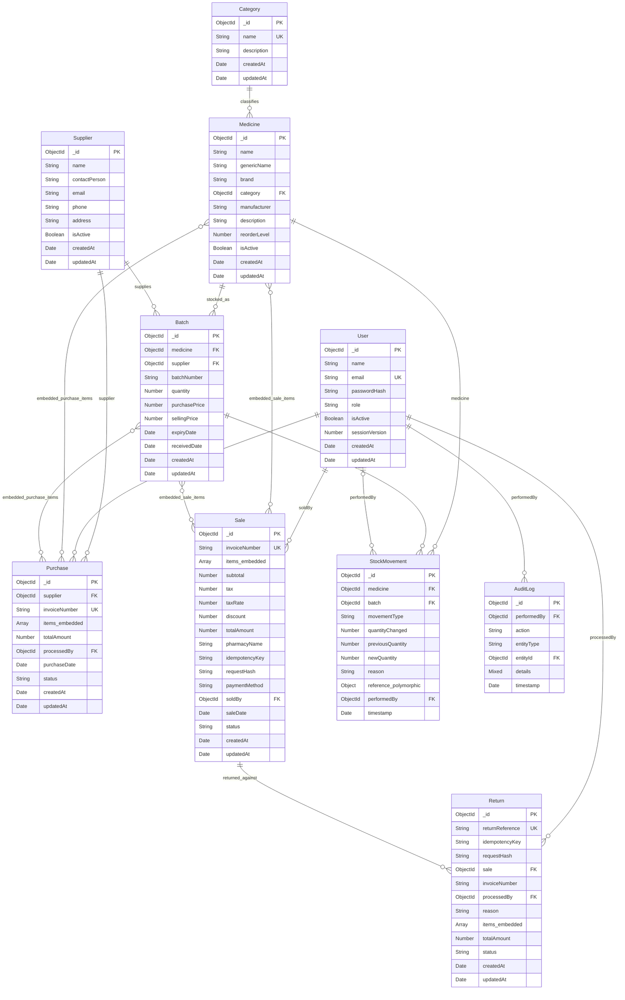

# PharmaCare Entity–Relationship Diagram

This data model is derived from the registered Mongoose models in
`server/src/models/`. It describes MongoDB collections and embedded
subdocuments as implemented; it does not imply relational database foreign-key
enforcement. References are ObjectIds populated or checked by application
logic.

## Mermaid ER diagram

### Diagram notation and MongoDB interpretation

- `PK` is Mongoose's implicit document `_id` ObjectId. Mongoose also adds
  `__v` to models unless disabled; `StockMovement` and `AuditLog` explicitly
  disable the version key.
- `FK` denotes an ObjectId application-level reference configured with
  Mongoose `ref` or `refPath`; MongoDB does not enforce it as a foreign key.
  `StockMovement.performedBy` is optional, while `StockMovement.reference` and
  `AuditLog.entityId` are polymorphic (`refPath`) references.
- `UK` denotes an explicit unique index or a unique single-field index.
- `items_embedded` denotes an array stored inside its parent document. The
  purchase, sale, and return item schemas set `_id: false`; they are not
  separate collections.
- `reference_polymorphic` (`StockMovement.reference.model` and `.id`) and
  `AuditLog.entityType` / `.entityId` use `refPath` rather than one fixed
  target. They are listed as polymorphic references in the text rather than
  drawing unsupported fixed-target relationships.

## Collection descriptions

### `User`

Stores account identity and authorization attributes: `name`, normalized
`email`, `passwordHash`, `role`, `isActive`, and `sessionVersion`, plus
timestamps. The `password` virtual is an input setter; it is not a persisted
field. The password hash is bcrypt-hashed before save and excluded from
ordinary queries. Roles are `admin`, `pharmacist`, `cashier`, and `customer`.

### `Category`

Stores a unique category `name` and optional `description`, with timestamps.
`Medicine.category` references this collection. Category deletion is blocked
by service logic while a medicine references it.

### `Medicine`

Stores catalog data: `name`, `genericName`, `brand`, `category`,
`manufacturer`, `description`, `reorderLevel`, and `isActive`, with
timestamps. It intentionally has no stock quantity or current price field.
Stock and current catalog price are derived from eligible batches.

### `Supplier`

Stores `name`, `contactPerson`, `email`, `phone`, `address`, and `isActive`,
with timestamps. It is referenced by both `Batch` and `Purchase`.

### `Batch`

Stores one medicine/supplier lot, including `batchNumber`, current integer
`quantity`, `purchasePrice`, `sellingPrice`, `expiryDate`, and `receivedDate`,
with timestamps. Batch quantity is the authoritative mutable on-hand count.

### `Purchase`

Stores a supplier receipt with unique `invoiceNumber`, an embedded `items`
array, `totalAmount`, `processedBy`, `purchaseDate`, and `status`, plus
timestamps. Each embedded line contains references to `medicine` and `batch`,
and snapshots `batchNumber`, `quantity`, `unitPrice`, `sellingPrice`,
`expiryDate`, and `lineTotal`.

### `Sale`

Stores invoice and sale totals: `invoiceNumber`, `items`, `subtotal`, `tax`,
`taxRate`, `discount`, `totalAmount`, `pharmacyName`, `idempotencyKey`,
`requestHash`, `paymentMethod`, `soldBy`, `saleDate`, and `status`, plus
timestamps. Each embedded item refers to `medicine` and `batch` and snapshots
medicine names, brand, batch number, quantity, returned quantity, unit price,
and line total.

### `Return`

Stores a return reference, idempotency metadata, source `sale`, invoice
number, `processedBy`, reason, embedded `items`, refund `totalAmount`, and
status, plus timestamps. Each embedded line references a medicine and batch
and records batch number, quantity, unit price, and refund amount. Return
items have `_id: false` and are stored inside the `Return` document.

### `StockMovement`

Stores append-only inventory history: `medicine`, `batch`, `movementType`,
signed `quantityChanged`, `previousQuantity`, `newQuantity`, `reason`,
optional `reference`, optional `performedBy`, and `timestamp`. Validation
requires integer quantities and checks
`previousQuantity + quantityChanged === newQuantity`.

### `AuditLog`

Stores append-only selected business actions: `performedBy`, `action`,
`entityType`, `entityId`, `details`, and `timestamp`. `entityId` uses a
`refPath` selected from the enum `User`, `Category`, `Medicine`, `Supplier`,
`Batch`, `Purchase`, `Return`, `Sale`, or `StockMovement`.

## References, cardinality, and indexes

All relationships below are based on fields and service workflows, not on
server-enforced referential constraints. A referenced document can become
orphaned through out-of-band database edits.

| Source field | Target | Relationship represented in the application |
| --- | --- | --- |
| `Medicine.category` | `Category` | One category is referenced by many medicines; each medicine has one required category |
| `Batch.medicine` | `Medicine` | One medicine can have many batches; each batch references one medicine |
| `Batch.supplier` | `Supplier` | One supplier can supply many batches; each batch references one supplier |
| `Purchase.supplier` | `Supplier` | One supplier can have many purchase documents |
| `Purchase.processedBy` | `User` | One user can process many purchase documents |
| `Purchase.items[].medicine` | `Medicine` | Embedded purchase lines reference medicines; many-to-many across documents |
| `Purchase.items[].batch` | `Batch` | Embedded purchase lines reference the received batches |
| `Sale.soldBy` | `User` | One user can process many sales |
| `Sale.items[].medicine` / `batch` | `Medicine` / `Batch` | Embedded sale-line references retain the allocated stock sources |
| `Return.sale` | `Sale` | One sale can be referenced by multiple return documents |
| `Return.processedBy` | `User` | One user can process many returns |
| `Return.items[].medicine` / `batch` | `Medicine` / `Batch` | Embedded return lines reference the original sold products and batches |
| `StockMovement.medicine` / `batch` | `Medicine` / `Batch` | One medicine or batch can have many movement records |
| `StockMovement.performedBy` | `User` | Optional actor reference |
| `StockMovement.reference` | `Purchase` or `Sale` | Optional polymorphic document reference (`refPath`) |
| `AuditLog.performedBy` | `User` | One user can have many audit entries |
| `AuditLog.entityType` / `entityId` | Enumerated model | Polymorphic entity reference (`refPath`) |

Explicit schema indexes:

| Collection | Index | Unique |
| --- | --- | --- |
| `User` | `{ email: 1 }` | Yes |
| `Category` | `{ name: 1 }` | Yes |
| `Medicine` | `{ category: 1 }` | No (`category` also declares `index: true`) |
| `Medicine` | `{ name: 1, genericName: 1 }` | No |
| `Supplier` | `{ name: 1 }` | No |
| `Batch` | `{ medicine: 1, batchNumber: 1 }` | Yes |
| `Batch` | `{ medicine: 1, expiryDate: 1 }` | No |
| `Batch` | `{ supplier: 1, receivedDate: -1 }` | No |
| `Purchase` | `{ invoiceNumber: 1 }` | Yes |
| `Purchase` | `{ purchaseDate: -1 }` | No |
| `Sale` | `{ invoiceNumber: 1 }` | Yes |
| `Sale` | `{ soldBy: 1, idempotencyKey: 1 }` | Yes, sparse |
| `Sale` | `{ saleDate: -1 }` | No |
| `Sale` | `{ soldBy: 1, saleDate: -1 }` | No |
| `Return` | `{ returnReference: 1 }` | Yes |
| `Return` | `{ processedBy: 1, idempotencyKey: 1 }` | Yes |
| `Return` | `{ sale: 1, createdAt: -1 }` | No |
| `StockMovement` | `{ medicine: 1, timestamp: -1 }` | No |
| `StockMovement` | `{ batch: 1, timestamp: -1 }` | No |
| `StockMovement` | `{ performedBy: 1, timestamp: -1 }` | No |
| `AuditLog` | `{ performedBy: 1, timestamp: -1 }` | No |
| `AuditLog` | `{ entityType: 1, entityId: 1, timestamp: -1 }` | No |

Every model also has MongoDB's standard `_id` index. Mongoose timestamps add
`createdAt` and `updatedAt` to schemas that enable `{ timestamps: true }`;
those timestamp fields are not separately indexed unless shown above.

## Inventory storage and batch-level stock

The `Medicine` collection holds descriptive catalog records only. Each
`Batch` holds the quantity, purchase price, selling price, supplier, expiry,
and received date for a specific medicine lot. Current total quantity is
calculated across its batches; sellable availability further excludes
inactive medicines and batches that are empty or expired. No separate
Medicine-level quantity is updated.

Purchases create `Batch` records. Sales and adjustments modify batch
`quantity` under conditional update rules. This structure preserves
batch-specific expiry and price information and enables First Expiry, First
Out allocation.

## Stock movement history

`StockMovement` is an append-only ledger of signed changes and before/after
quantity values. Purchase, sale, and stock-adjustment workflows create
movement rows in the same transaction as their inventory changes. The model
checks the arithmetic relationship between the signed delta and old/new
quantities. Returns currently update return/sale records and create an audit
entry but do not add stock or create a return movement. Seeded opening batch
quantities do not receive movement entries, so historical movement sums may
not reconcile to initial stock.

## Sale item snapshots

`Sale.items` embeds line snapshots with `_id: false`; it is not a separate
collection. A line records the allocated `medicine` and `batch` ObjectIds
alongside the medicine name, generic name, brand, batch number, quantity,
returned quantity, unit price, and line total at sale time. These snapshots
allow invoices and historical sales to retain the names, lot, and price used
for that sale even if the catalog later changes. The reference ObjectIds
remain useful for navigation and traceability but are not the sole source of
historical display values.

## Scope and implementation notes

- `Return` is an implemented Mongoose model and collection even though it is
  absent from some earlier abbreviated collection lists.
- `Purchase.items`, `Sale.items`, and `Return.items` are embedded arrays with
  no subdocument `_id`; they are not collections or independently addressable
  entities.
- `StockMovement` permits movement type `return`, but current return
  processing does not create one.
- This diagram describes Mongoose schema references and service behavior;
  MongoDB does not provide automatic foreign-key integrity for these fields.
