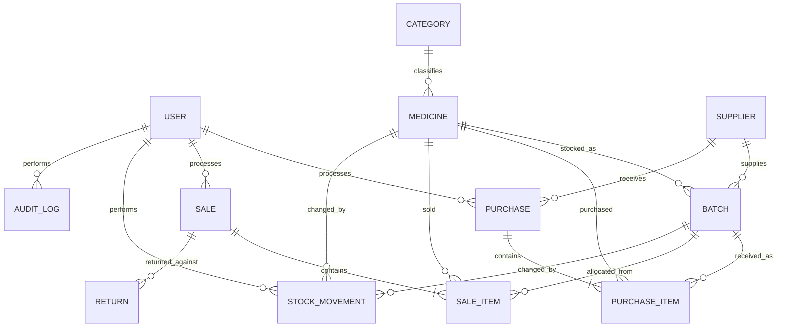

# PharmaCare Technical Report

## 1. Introduction

PharmaCare is a MERN pharmacy management system intended to coordinate a
pharmacy's product catalog, suppliers, purchases, batch inventory, sales,
returns, and operational reporting. It uses a React/Vite client and an
Express/Mongoose API backed by MongoDB.

The client provides a role-aware workspace for administration, pharmacists,
cashiers, and customers. The server remains the security boundary and performs
all authentication, authorization, validation, inventory allocation, and
financial calculations.

## 2. Problem statement

Pharmacy stock is tied to individual supplier batches and expiry dates. A
medicine-level stock count is insufficient for expiry-aware dispensing and can
drift from actual purchases, sales, returns, and adjustments. The system
therefore needs to preserve batch identity and make stock changes auditable.

The application addresses this through batch-level quantities, FEFO
allocation, transaction-backed writes, stock movements, and reporting based on
the persisted business records.

## 3. Architecture decisions

- **Controller/service/route separation:** Express route definitions apply
  authentication, permission checks, and Zod validation. Controllers handle
  HTTP adaptation; services implement business rules and database writes.
- **MongoDB references plus historical snapshots:** Categories, medicines,
  suppliers, batches, users, and transactions use Mongoose references. Sale
  and purchase line items retain names, batch numbers, and prices as snapshots
  so later catalog changes do not rewrite history.
- **Role-based backend enforcement:** Roles are `admin`, `pharmacist`,
  `cashier`, and `customer`. The UI hides unavailable actions for usability,
  but each API route independently checks roles or permissions.
- **Transactions for coupled writes:** Purchase receipt, sale, return, and
  stock adjustment operations write their primary record, stock changes,
  movement history, and audit history in MongoDB transactions.
- **Append-only audit records:** Stock movements and audit logs are designed
  as append-only history rather than mutable current-state records.
- **Server-side validation:** Zod validates request shape and values; Mongoose
  validates persisted model constraints. The server derives item prices,
  totals, taxes, and available inventory.

## 4. Database design

Principal relationships:

Medicine documents do not store editable total stock. `Batch` holds a
medicine/supplier reference, a medicine-scoped batch number, quantity, cost
price, selling price, expiry, and received date. Purchases, sales, and returns
retain their own line-item records and identifiers; returns link to their
original sale. Unique indexes protect user email, sale invoice number,
idempotency keys, and scoped batch identities.

## 5. FEFO implementation

First Expiry, First Out (FEFO) sorts eligible batches by expiry date ascending
and uses the batch ID as a deterministic tie-breaker. A batch is eligible only
when its medicine is active, its expiry date is later than the current time,
and its quantity is positive.

For example, suppose a sale requests 7 units, and eligible batches contain:

| Batch | Expiry | Available |
| --- | --- | ---: |
| `A-102` | 2027-03-01 | 4 |
| `B-205` | 2027-06-15 | 5 |

The allocator takes 4 units from `A-102`, then 3 from `B-205`. Expired batches
and batches with zero quantity are not considered. If eligible quantity totals
less than the request, the sale is rejected without a partial commit.

## 6. Inventory integrity

Every purchase creates a new batch rather than overwriting a prior batch
quantity. Sales allocate FEFO batches inside a MongoDB transaction and apply
conditional quantity decrements (`quantity >= requested decrement`). If a
concurrent update changes a batch or stock is insufficient, the transaction
fails instead of creating negative inventory.

Each successful stock change records medicine, batch, movement type, previous
quantity, signed quantity change, new quantity, reason, actor, timestamp, and
reference where applicable. Purchases, sales, and adjustments also create
audit history atomically. Returns decrement the remaining return allowance on
the original sale but do not increase sellable batch quantity; their status is
`pending_inspection`.

The stock report aggregates stock movements by date and movement type and
compares derived current stock with the movement ledger. Legacy or seeded
opening quantities without matching opening stock movements appear as a
reconciliation difference; seed data is for development and does not create
purchase or movement history.

## 7. Authentication and authorization

Passwords are hashed with bcryptjs. Login returns a signed JWT access token;
the token is validated for signature, expiry, subject, and session version.
Logout increments the user's session version so existing tokens are rejected.
Deactivated accounts are rejected on authenticated requests. Public customer
registration cannot choose a staff role.

Role and permission middleware restricts internal supplier, purchasing,
inventory-management, returns, reports, and user-management APIs. Request
validation rejects unknown or malformed fields. Helmet, CORS allowlisting,
JSON body limits, and rate limiting on registration/login provide additional
baseline protections.

Frontend route guards and role-specific navigation are convenience layers and
are not trusted for security. The API is authoritative.
Customer medicine responses are projected to catalog fields and a selling
price from the earliest eligible batch; they do not include reorder levels or
batch purchase costs.

## 8. Testing methodology

The project has:

- Node's test runner for unit/service/model/validation and mocked API behavior,
  including FEFO ordering, expired stock, concurrency guards, transaction
  rollback paths, report calculations, and return limits.
- Jest with Supertest for HTTP integration coverage of login, invalid
  credentials, expired JWTs, customer authorization denial, OpenAPI
  availability, and authentication rate limiting.
- Client ESLint and Vite production-build checks.

The source test suite mocks database methods in many tests. A replica-set
integration environment should additionally be used before release to exercise
real MongoDB transaction semantics, indexes, and concurrent writes.

## 9. Security considerations

- Keep `JWT_SECRET` and MongoDB credentials in ignored server environment
  files or a deployment secrets manager. Never expose them through `VITE_*`
  client variables.
- Use HTTPS, a narrowly configured `CLIENT_ORIGIN`, production-safe logging,
  database backups, and appropriate MongoDB network access controls in a
  deployment.
- Configure and monitor login/register rate limits for the deployment's
  proxy topology. The in-memory limiter is per process and is not a distributed
  rate-limit store.
- Use a MongoDB replica set or `mongos` for transactional operations.
- Do not use the development seed records as real medicine advice or inventory.
- No production deployment URL, staff demo password, or live payment
  integration is included.

The completed code review reported no exploitable vulnerability in the
reviewed implementation. Dependency-manager audit warnings are a separate
third-party dependency risk and must be assessed against the lockfile and
deployment policy before release.

## 10. Known limitations

- Sales currently record the cashier/processor but do not associate a customer
  account with an invoice. Customer-specific purchase history and personal
  invoice browsing are therefore not implemented.
- Customer catalog pricing reflects the earliest eligible batch. Price can
  differ across batches when FEFO allocation spans multiple batches.
- Payment methods are simulated; no payment gateway is connected.
- Returns remain pending inspection. A dedicated inspection and restock
  release workflow is not implemented.
- The seed script creates fictional catalog, suppliers, and batches, but does
  not create the initial staff administrator or transaction history.
- The in-memory rate limiter does not coordinate limits across multiple server
  instances.
- A production deployment, monitoring/backup policy, and private admin
  bootstrap are deployment-owner responsibilities.
